<div align="center">

# Deskcraft

**A full-stack desk-setup store with accounts, Stripe Checkout, order tracking and an admin area, where pricing, stock, payment state and access are enforced in PostgreSQL.**


[Features](#features) · [Design](#design) · [Screenshots](#screenshots) · [Tech stack](#tech-stack) · [Getting started](#getting-started)

</div>

<br>

<p align="center">
<picture>
  <source media="(prefers-color-scheme: dark)" srcset="readme/hero-dark.png">
  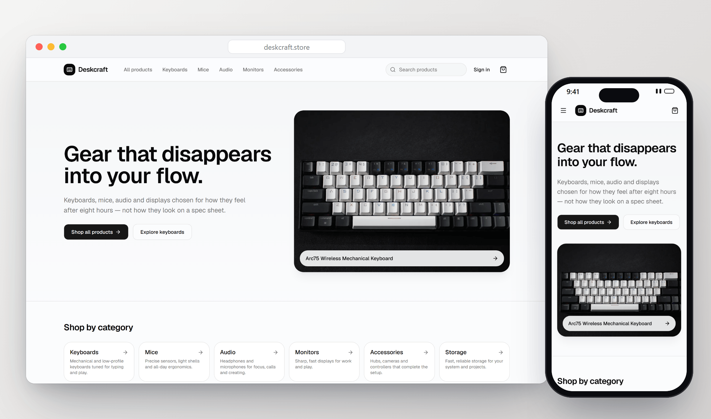
</picture>
</p>

## Overview

Customers browse a catalog, build a cart, create an account and pay through Stripe Checkout. Payment is confirmed asynchronously by a signature-verified Stripe webhook, which is the only thing that can mark an order as paid. Administrators manage products, stock and the fulfilment lifecycle from a protected admin area.

The project focuses on the parts of e-commerce that are easy to get wrong:

- **Who can read or change which data**, enforced by Row Level Security in Postgres, not only by the UI.
- **What a customer pays.** Prices always come from the database, never from the browser.
- **When an order counts as paid.** Only when a verified webhook says so, processed exactly once.
- **Stock consistency.** Stock can't be oversold or left stuck in abandoned checkouts.

All products, prices and accounts are fictional. Prices are in USD.

## Try the demo

Run it locally (see [Getting started](#getting-started)), then sign in with the demo accounts created by `npm run seed:users`:

| Role | Email | Password |
| --- | --- | --- |
| Customer | `customer@deskcraft.test` | see `DEMO_CUSTOMER_PASSWORD` in `.env.example` |
| Admin | `admin@deskcraft.test` | see `DEMO_ADMIN_PASSWORD` in `.env.example` |

The customer comes with six demo orders, one in each lifecycle state, from `scripts/seed-demo-orders.sql`. With Stripe test keys configured, pay with card `4242 4242 4242 4242`, any future expiry and any CVC.

## Features

### A catalog with live stock

Twelve products in six categories with search, category filters and sorting. Every card shows its stock state, and sold-out products can't be added to the cart.

<p align="center">
<picture>
  <source media="(prefers-color-scheme: dark)" srcset="readme/catalog-dark.png">
  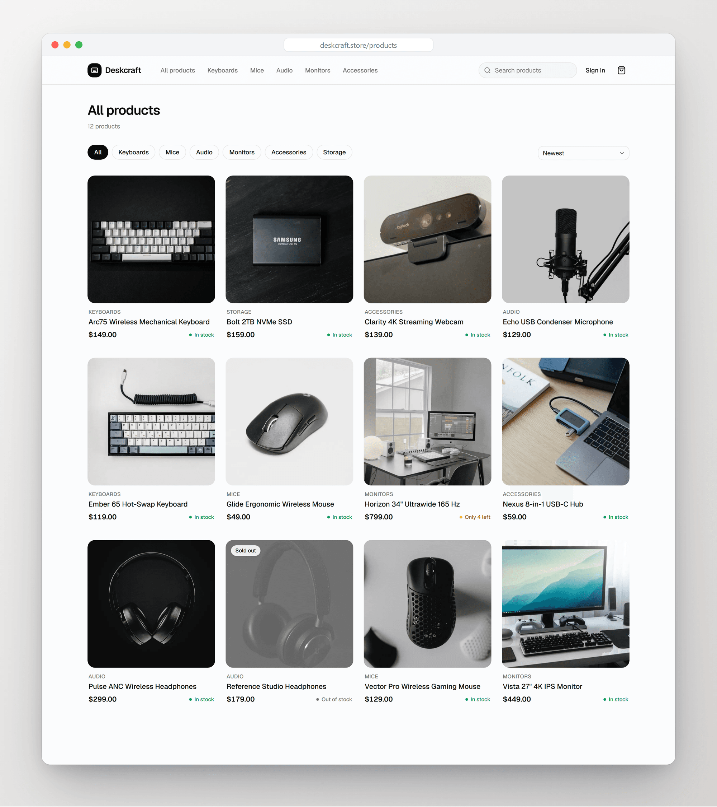
</picture>
</p>

### Product page and cart

Price, stock status, quantity and add to cart, with related products below. The cart keeps only product ids and quantities in `localStorage`, caps quantities by stock and asks the customer to sign in before checkout.

| | |
| --- | --- |
| <picture><source media="(prefers-color-scheme: dark)" srcset="readme/product-dark.png">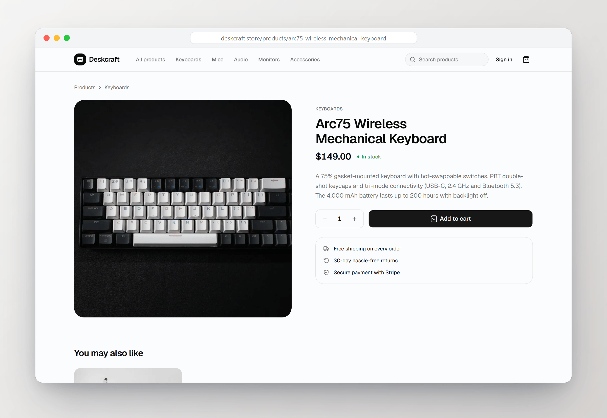</picture> | <picture><source media="(prefers-color-scheme: dark)" srcset="readme/cart-dark.png">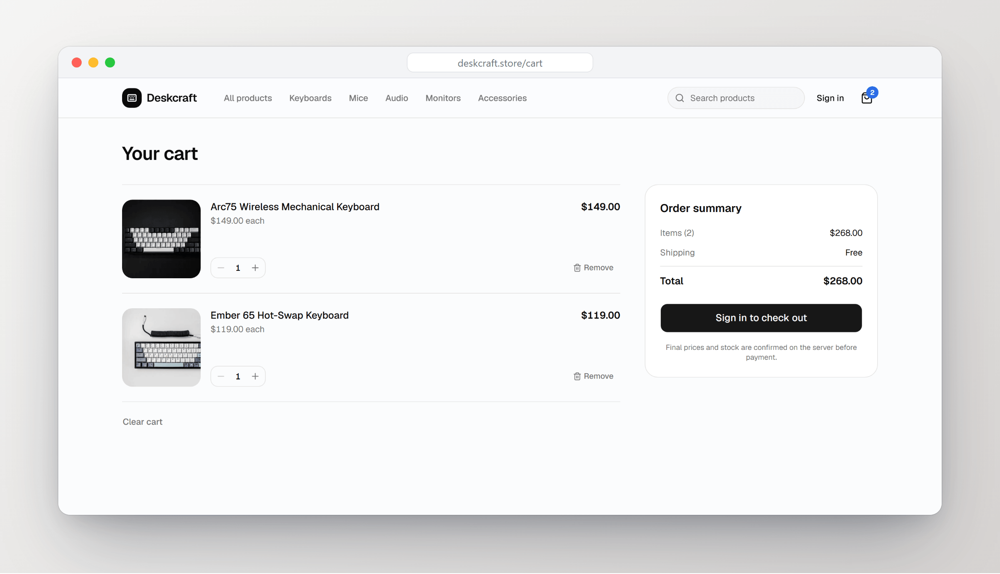</picture> |

### Order tracking for customers

Customers see their own orders only, each with a lifecycle timeline from placed to delivered.

<p align="center">
<picture>
  <source media="(prefers-color-scheme: dark)" srcset="readme/order-dark.png">
  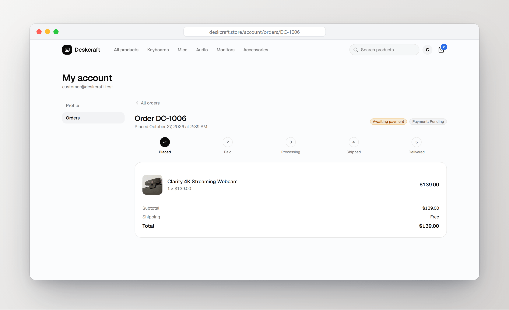
</picture>
</p>

### An admin area for the whole lifecycle

Revenue from paid orders, the fulfilment queue, orders awaiting payment and low stock on one dashboard. Admins create and edit products, adjust stock inline and advance orders; the customer is emailed on each change.

<p align="center">
<picture>
  <source media="(prefers-color-scheme: dark)" srcset="readme/admin-dark.png">
  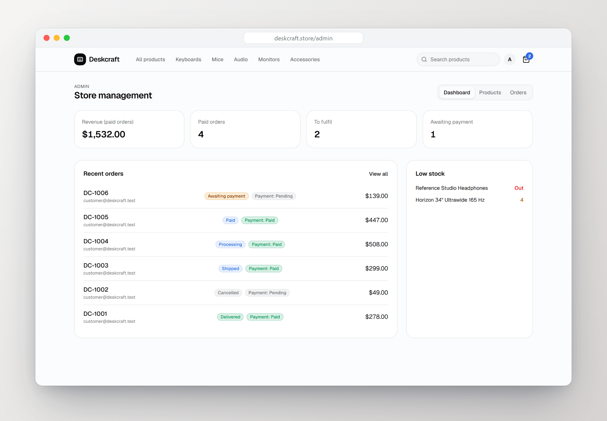
</picture>
</p>

| | |
| --- | --- |
| <picture><source media="(prefers-color-scheme: dark)" srcset="readme/admin-order-dark.png">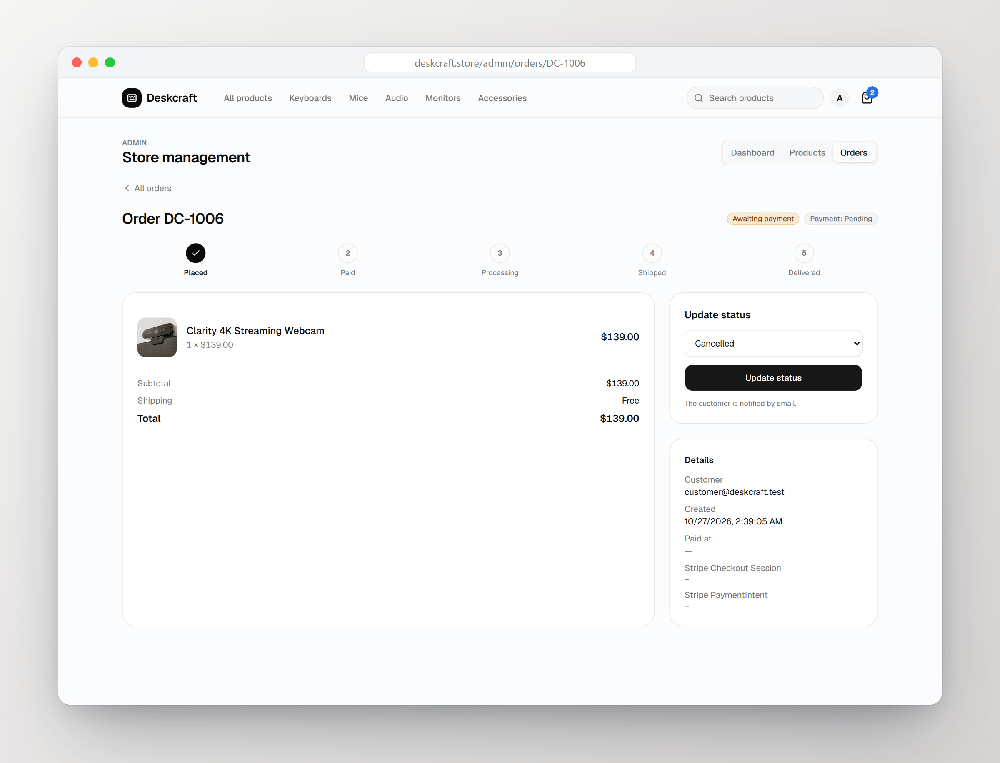</picture> | <picture><source media="(prefers-color-scheme: dark)" srcset="readme/admin-products-dark.png">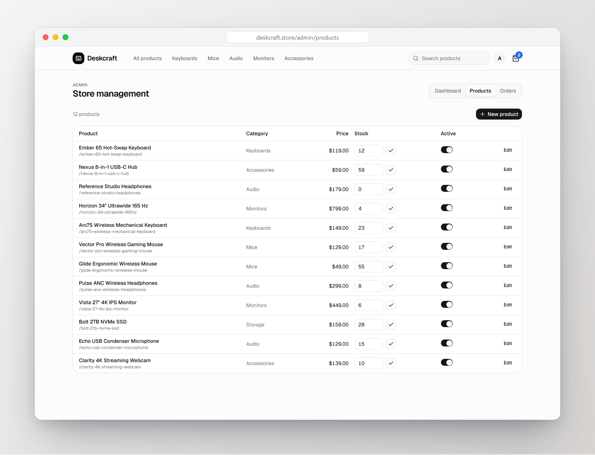</picture> |

<details>
<summary><b>Full feature list</b></summary>

**Storefront**
- Catalog of 12 products in 6 categories with search, category filters and sorting.
- Product pages with live stock status. Out-of-stock products can't be added to the cart.
- Cart with quantity limits from stock and a per-item maximum, stored in `localStorage` as product ids and quantities only.
- Responsive layout with loading, empty, error and not-found states.

**Accounts** (Supabase Auth)
- Sign up with email confirmation, sign in, sign out and cookie sessions.
- Password recovery and reset by email.
- Profile page, order history and order tracking with a lifecycle timeline, limited to the customer's own data.

**Checkout and payments** (Stripe)
- A Checkout Session is created on the server from database prices.
- Stock is reserved atomically when the order is created and released if checkout expires, fails or can't start.
- Webhook-driven payment confirmation with signature verification and idempotent processing.
- The success page shows the state the webhook wrote; landing on it doesn't confirm payment.

**Orders and inventory**
- Orders keep snapshots of product name and unit price, so later price changes never alter past orders.
- Lifecycle enforced by a database trigger: `pending → paid → processing → shipped → delivered`, with `cancelled` allowed before shipping.
- Cancelling an order puts its stock back automatically.

**Admin area** (role `admin`)
- Dashboard with revenue from paid orders, orders to fulfil, orders awaiting payment and a low-stock list.
- Create and edit products, toggle them active, adjust stock inline.
- Filter orders by status and advance them; the customer is emailed on each change.

**Transactional email** (Resend)
- Order confirmation, payment failed, status updates and a welcome email. Without `RESEND_API_KEY`, emails are logged to the server console.

</details>

## Design

- **shadcn/ui on design tokens.** Components read CSS variables (`--background`, `--card`, `--primary`, `--muted`, `--ring` and more) through Tailwind 4's `@theme`, so the whole store follows one neutral palette.
- **Light and dark.** A complete `.dark` palette is defined with a `dark` custom variant; every screenshot here exists in both themes and switches with your GitHub theme. The app has no theme switch in the UI yet.
- **Product photography first.** Square, rounded image cards on a quiet zinc palette, with small uppercase category labels and status dots for stock.
- **Status at a glance.** Colour-coded pills for order and payment status in the account and admin areas.
- **Responsive.** The header collapses to a menu, category chips scroll horizontally on phones and the admin dashboard stacks into single-column cards.
- **States.** Loading, empty, error and not-found states across the storefront and admin.

<p align="center">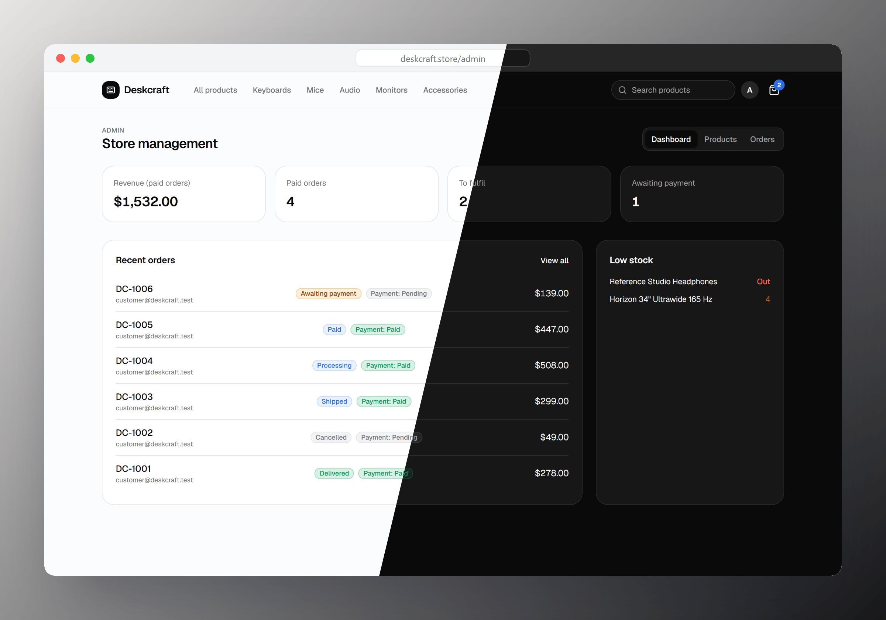</p>

<p align="center">
<picture>
  <source media="(prefers-color-scheme: dark)" srcset="readme/mobile-dark.png">
  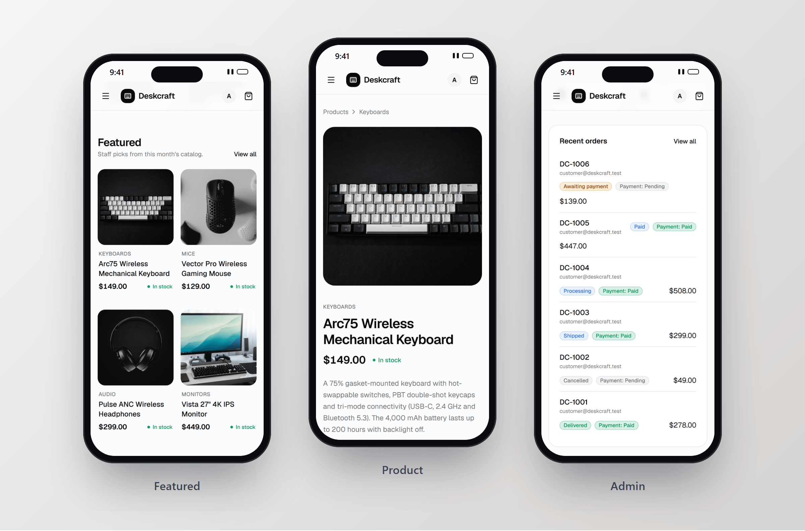
</picture>
</p>

## Screenshots

All screenshots come from the running app with the seeded demo data: desktop at 1440×900 and mobile at 390×844, both at retina resolution. Images switch to dark versions when GitHub is in dark mode.

## Tech stack

| Layer | Technology | Why |
| --- | --- | --- |
| Framework | Next.js 16.3 (App Router, Server Actions, Turbopack), React 19.2, TypeScript 5 | Server-rendered pages and typed mutations without a separate API layer |
| UI | Tailwind CSS 4, shadcn/ui on Radix UI, lucide-react, sonner | Accessible primitives on a token-based palette with light and dark themes |
| Backend and data | Supabase (Auth, PostgreSQL), `@supabase/ssr` 0.12, `@supabase/supabase-js` 2 | Row Level Security, triggers and functions hold the business rules |
| Payments | Stripe Checkout and webhooks (`stripe` Node SDK 23) | Hosted payment, with the webhook as the single source of truth |
| Email | Resend 6 | Transactional emails, logged to the console when no key is set |
| Validation | Zod 4 | Every Server Action and route validates its input |
| Testing | Vitest 5, pgTAP through the Supabase CLI, Playwright 1.63 | Database rules are tested in the database itself |
| Tooling | ESLint 9, Prettier 3, Supabase CLI | One command each for lint, format, types and migrations |

## Architecture

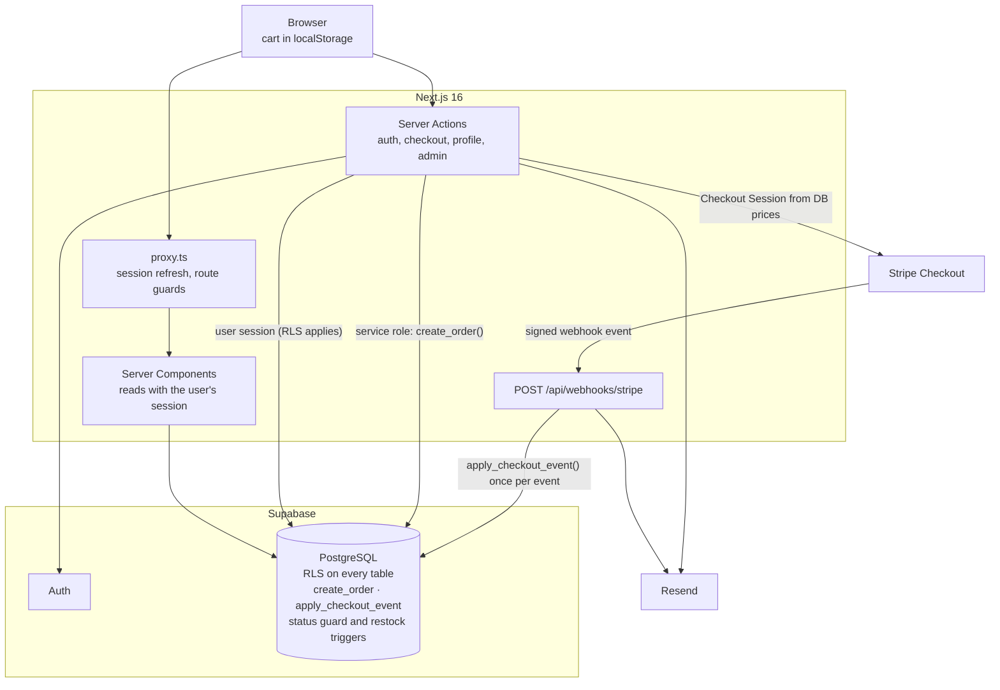

**Checkout flow**

1. `startCheckout` (`src/lib/checkout/actions.ts`) requires a signed-in user and validates the cart with Zod. Unknown fields such as a price are stripped.
2. `create_order()` runs as one transaction: it caps a customer at 3 pending orders per hour, locks the product rows in a fixed order, checks each is active and in stock, decrements stock and inserts the order with database price snapshots.
3. A Stripe Checkout Session is built from the stored order with a 30-minute expiry and a per-order idempotency key. On any failure the session is expired and the stock released.
4. The webhook verifies the signature on the raw body, maps the event and calls `apply_checkout_event()`. That records the event id in a ledger, checks amount and currency against the order and makes a guarded `pending → paid` transition, or cancels and restocks on failure or expiry. A duplicate event is a no-op.
5. On a fresh `paid` transition, the confirmation email is claimed with a conditional update so it is sent at most once.

**Key decisions**

- **Rules live in the database.** Status transitions, stock limits, price checks and access control are triggers, constraints, `SECURITY DEFINER` functions and RLS policies, so they hold for every code path, including admin actions.
- **Two Supabase clients on purpose.** Everything a user does, admins included, goes through the request-scoped client with the user's session, so RLS always applies. The service-role client (`server-only`) is used only for creating orders, applying webhook events and email bookkeeping.
- **The webhook is the source of truth.** Arriving on the success page or returning from Stripe changes nothing. Webhook writes and the event ledger share a transaction, so a failed write returns `500` and Stripe retries.
- **Authorization in three layers.** Page guards, `assertAdmin()` in every admin Server Action, and RLS. Admins can update only the order `status` column, never money fields.
- **Hardening.** Safe same-origin redirects for `?next=`, HTML-escaped email templates, an allowlist for product image URLs, and security headers (`X-Frame-Options`, HSTS, `Referrer-Policy`, `Permissions-Policy`).

## Engineering highlights

- **The database enforces the order lifecycle.** A `before update` trigger rejects any status change that isn't a legal transition, and refuses fulfilment states unless the payment is `paid`, whoever runs the query.
- **Atomic stock reservation.** `create_order` locks each product row in a fixed order (no deadlocks), checks stock, decrements it and snapshots name and price into the order, all in one transaction.
- **Stock comes back by itself.** Cancelling an order or an expired checkout returns stock through a trigger, so abandoned checkouts never strand inventory.
- **Idempotent webhooks.** Stripe events are applied through `apply_checkout_event`, so a retried event can't double-confirm an order.

```sql
-- supabase/migrations/20261003000001_initial_schema.sql
create or replace function public.guard_order_status_change()
returns trigger language plpgsql set search_path = '' as $$
begin
  if new.status is not distinct from old.status then
    return new;
  end if;

  if new.status in ('paid', 'processing', 'shipped', 'delivered') and new.payment_status <> 'paid' then
    raise exception 'ORDER_NOT_PAID' using errcode = 'check_violation';
  end if;

  if not (
       (old.status = 'pending'    and new.status in ('paid', 'cancelled'))
    or (old.status = 'paid'       and new.status in ('processing', 'shipped', 'cancelled'))
    or (old.status = 'processing' and new.status in ('shipped', 'cancelled'))
    or (old.status = 'shipped'    and new.status = 'delivered')
  ) then
    raise exception 'INVALID_STATUS_TRANSITION' using errcode = 'check_violation';
  end if;

  return new;
end;
$$;
```

```sql
-- inside public.create_order(...)
for v_item in
  select (e ->> 'product_id')::uuid as product_id, (e ->> 'quantity')::int as quantity
  from jsonb_array_elements(p_items) e
  order by 1 -- deterministic lock order avoids deadlocks
loop
  select * into v_product from public.products where id = v_item.product_id for update;

  if v_product.stock_quantity < v_item.quantity then
    raise exception 'INSUFFICIENT_STOCK:%', v_item.product_id using errcode = 'P0001';
  end if;

  update public.products
    set stock_quantity = stock_quantity - v_item.quantity
    where id = v_product.id;
  -- ...insert the order item with a snapshot of name and unit price...
end loop;
```

## Getting started

**Prerequisites**

- Node.js 20.9 or newer and npm
- Docker, for the local Supabase stack
- Optional: a Stripe account in test mode with the [Stripe CLI](https://docs.stripe.com/stripe-cli), and a Resend account

**Setup**

```bash
git clone <repository-url> deskcraft
cd deskcraft
npm install
```

Start Supabase locally. The API runs on port 56521, Studio on 56523 and the auth email inbox on 56524 (see `supabase/config.toml`).

```bash
npx supabase start
```

Apply the migrations and seed the catalog:

```bash
npm run db:reset
```

Create `.env.local` and fill in the Supabase URL and keys printed by `npx supabase status`:

```bash
cp .env.example .env.local
```

Create the demo accounts and their order history:

```bash
npm run seed:users
```

```bash
docker exec -i supabase_db_deskcraft psql -U postgres -d postgres < scripts/seed-demo-orders.sql
```

Run the app on the port the auth redirect URLs expect:

```bash
npx next dev -p 4107
```

Open http://localhost:4107.

**Stripe (local)**

1. Put a test-mode secret key in `STRIPE_SECRET_KEY`.
2. Log the Stripe CLI in to the same account, then forward the handled events:
   ```bash
   stripe listen --events checkout.session.completed,checkout.session.async_payment_succeeded,checkout.session.async_payment_failed,checkout.session.expired --forward-to localhost:4107/api/webhooks/stripe
   ```
3. Copy the printed `whsec_…` value into `STRIPE_WEBHOOK_SECRET` and restart the dev server.

Without Stripe keys, everything except paying works.


<details>
<summary><b>Environment variables</b></summary>

| Variable | Required | Purpose |
| --- | --- | --- |
| `NEXT_PUBLIC_SITE_URL` | yes | Base URL for Stripe redirects and email links. Baked in at build time. |
| `NEXT_PUBLIC_SUPABASE_URL` | yes | Supabase API URL |
| `NEXT_PUBLIC_SUPABASE_ANON_KEY` | yes | Public anon key, protected by RLS |
| `SUPABASE_SERVICE_ROLE_KEY` | yes | Server only. Bypasses RLS. |
| `STRIPE_SECRET_KEY` | for checkout | Stripe secret key (test mode) |
| `STRIPE_WEBHOOK_SECRET` | for webhooks | Endpoint signing secret, or the one printed by `stripe listen` |
| `RESEND_API_KEY` | optional | Without it, emails are logged instead of sent |
| `EMAIL_FROM` | optional | Sender address. `onboarding@resend.dev` works for testing. |
| `DEMO_ADMIN_EMAIL`, `DEMO_ADMIN_PASSWORD`, `DEMO_CUSTOMER_EMAIL`, `DEMO_CUSTOMER_PASSWORD` | local only | Used by `npm run seed:users` |

</details>

<details>
<summary><b>Scripts</b></summary>

| Script | What it does |
| --- | --- |
| `npm run dev` | Development server |
| `npm run build` / `npm start` | Production build and server |
| `npm run lint` | ESLint |
| `npm run typecheck` | Generate route types, then `tsc --noEmit` |
| `npm test` | Vitest unit and integration tests |
| `npm run test:e2e` | Playwright end-to-end tests |
| `npm run test:db` | pgTAP database tests |
| `npm run db:reset` | Recreate the local database from migrations and seed |
| `npm run db:types` | Regenerate `src/lib/types/database.ts` |
| `npm run seed:users` | Create the demo admin and customer |
| `npm run format` | Prettier |

</details>

<details>
<summary><b>Project structure</b></summary>

```
src/
  app/
    api/webhooks/stripe/   Stripe webhook (signature check, idempotent processing)
    auth/confirm/          landing route for confirmation and recovery links
    products/ cart/ checkout/success/
    account/               profile, order history, order tracking
    admin/                 dashboard, products, orders
    sign-in/ sign-up/ forgot-password/ reset-password/
  components/              UI by area; components/ui holds shadcn/ui primitives
  lib/
    auth/ admin/ checkout/ Server Actions and queries
    cart/                  pure cart logic shared by client and server
    stripe/                client, Checkout Session builder, webhook processor
    email/                 Resend sender, templates, notifications
    orders/                order queries and status model
    supabase/              server, service-role and proxy clients
    validation/ security/  Zod schemas, safe redirects
    money.ts env.ts
  proxy.ts                 session refresh and protected-route redirects
supabase/
  migrations/              schema, RLS, SQL functions and triggers
  seed.sql                 6 categories and 12 products
  tests/database/          pgTAP tests
scripts/                   demo users and demo order history
public/products/           product photography
tests/ unit/ integration/ e2e/
```

</details>

## Testing & quality

| Command | Suite | What it covers |
| --- | --- | --- |
| `npm test` | Vitest, 83 tests (all passing) | Cart maths and limits, tampered cart data, Zod schemas, USD price parsing, redirect safety, Checkout Session parameters, webhook mapping and idempotency, signature verification, email escaping. Integration tests run the real webhook route against local Postgres. |
| `npm run test:db` | pgTAP, 27 tests | RLS for anonymous, customer and admin users, no self-promotion to admin, no direct order inserts, database-computed totals, stock and pending-order limits, no shipping unpaid orders, webhook idempotency. One test currently fails; see Roadmap. |
| `npm run test:e2e` | Playwright, desktop and mobile | Catalog, search, cart, sign-up with a real confirmation email, password recovery, protected routes, IDOR checks, admin product and order management, checkout start, a forged success page, mobile layout. |
| `npm run typecheck`, `npm run lint` | Static checks | TypeScript and ESLint. Typecheck passes. |

Integration, database and E2E tests need the local Supabase stack. Playwright starts its own server on port 3000 by default (`E2E_PORT` overrides it); auth email links follow `NEXT_PUBLIC_SITE_URL`.

## Deployment

Vercel for the app, a hosted Supabase project, Stripe in test mode and optionally Resend.

1. **Supabase.** Link the CLI (`npx supabase link --project-ref <ref>`) and run `npx supabase db push --include-seed`. Set the Site URL and redirect URLs (`https://<your-domain>/**`) under Authentication → URL Configuration, and configure custom SMTP for real users.
2. **Vercel.** Import the repository and set the environment variables above, with `NEXT_PUBLIC_SITE_URL=https://<your-domain>`. Redeploy after changing any `NEXT_PUBLIC_*` value.
3. **Stripe.** Add a webhook endpoint at `https://<your-domain>/api/webhooks/stripe` for the four `checkout.session.*` events, and put its signing secret in `STRIPE_WEBHOOK_SECRET`.
4. **Resend.** Set `RESEND_API_KEY`. To email any customer, verify a sending domain and set `EMAIL_FROM` to an address on it.

## Roadmap

- Fix pgTAP test 22 ("admin can see inactive products"): it looks for a product slug that is no longer in the seed. Add an inactive product to the seed or point the test at one created inside the test.
- Show the Storage category in the header navigation (it appears only in the catalog filters and home page).
- Shipping addresses, tax and shipping costs. The order total currently equals the subtotal.
- Automated refunds (the `refunded` payment status exists but nothing sets it).
- Retry failed confirmation emails, and a review queue for payments that arrive after an order was cancelled.
- Server-side cart so it follows a signed-in customer across devices.
- Image uploads for products and category management in the admin UI.
- A Content-Security-Policy header and application-level rate limiting.
- Add a theme switch so the existing dark palette can be used.